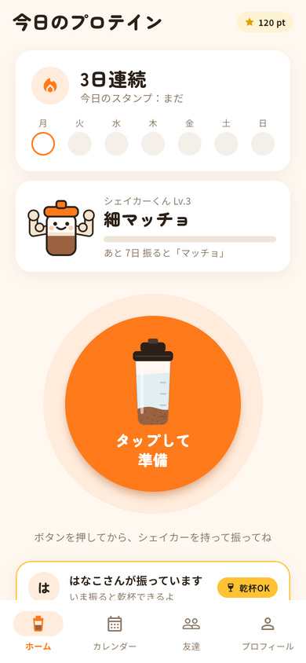

<!-- protein-kanpai:start -->
# プロテインで乾杯

シェイカーを振ったら、今日の筋トレ完了。友達と同時に振れば「乾杯」になる。運動を一人で続けられない人のためのアプリです。

- **公開版（スマホのブラウザで開く。iPhone は Safari）**：https://protein-kanpai-t071.web.app
  - 仮のデータで動く版。振る検知は本物で、iPhone の実機で確認済み。サーバーは実装とローカルでの接続確認まで済み、公開版にはまだつないでいない
- **アプリのソースと詳しい説明**：[app/README.md](app/README.md)
- **サーバー（FastAPI / Cloud Run 用）**：[app/backend/](app/backend/)、API の約束は [app/docs/api-contract.md](app/docs/api-contract.md)
- **プレゼン動画（1 分 24 秒。課題・実機デモ・しくみ・現状）**：[app/docs/video/presentation.mp4](app/docs/video/presentation.mp4)
- **実機デモ動画（30 秒。iPhone で実際に振っている手元と画面）**：[app/docs/video/demo.mp4](app/docs/video/demo.mp4)
- **紹介動画**：[app/docs/video/intro.mp4](app/docs/video/intro.mp4)
- **プロダクト説明**：[app/docs/product.md](app/docs/product.md)
- **アーキテクチャ図**：[app/docs/images/architecture.png](app/docs/images/architecture.png)
- **著作物利用シート**：[app/docs/copyright-sheet.md](app/docs/copyright-sheet.md)
- 開発用リポジトリ：https://github.com/kotakota914/protein-kanpai （`b385806` 時点の内容をコピー。サーバーと接続のコードはプルリクエスト #1・#2 として提出中）

<!-- protein-kanpai:end -->

---

# DevFest Hackathon 2026 提出用リポジトリ

  DevFest Hackathon 2026 のチームの **最終提出用** リポジトリです。提出期限までに、作品のコードと資料をこのリポジトリに置いてください。

  このリポジトリは **公開（public）** です。開催中も、運営・審査員・ほかの参加者が見られます。

  ## はじめに

  1. GitHub から届いた招待を受け入れてください（招待の期限は 7 日です）
  2. このリポジトリを clone して、提出物を置いてください

  招待の期限が切れたときや、メンバーが変わったときは、運営に連絡してください。

  ## 開発用のリポジトリは別に作ることをおすすめします

  このリポジトリでは **GitHub Actions と GitHub Pages が使えません**。CI やデプロイ、Pages での公開をしたいときは、チームで開発用のリポジトリを別に作ってください。

  - 開発用のリポジトリは、チームのメンバーのアカウントや、チームで作った Organization に作ってください
  - 開発はそちらで進めて、提出期限までに最終版のコードと資料をこのリポジトリに push してください
  - 審査はこのリポジトリの内容で行います。開発用のリポジトリにしかないものは、審査の対象になりません
  - デプロイした作品の URL があれば、この README に書いてください

  ## 秘密情報をコミットしない

  API キー・パスワード・サービスアカウントの鍵などは、**絶対にコミットしないでください**。公開リポジトリなので、push
  した時点で誰でも見られます。開発用のリポジトリから持ってくるときも、履歴ごと push すると、過去のコミットに含まれる秘密情報も公開されます。

  - 秘密情報は `.env` や `.dev.vars` などに書き、コミットしない（`.gitignore` に入れてあります）
  - 誤って push したら、すぐにキー（鍵）を無効にして作り直し、運営に連絡してください。履歴から消すだけでは不十分です
  - GitHub の push protection が、よく知られた形式のキーの push を止めることがあります。止められたら、そのキーをコミットから外してください

  ## 提出

  提出の方法と締切は、運営からの案内に従ってください。提出期限を過ぎると、このリポジトリは読み取り専用になり、push できなくなります。

  ## ライセンス

  [MIT License](LICENSE) です。ほかのライセンスにしたいときは、LICENSE を書き換えてください。
